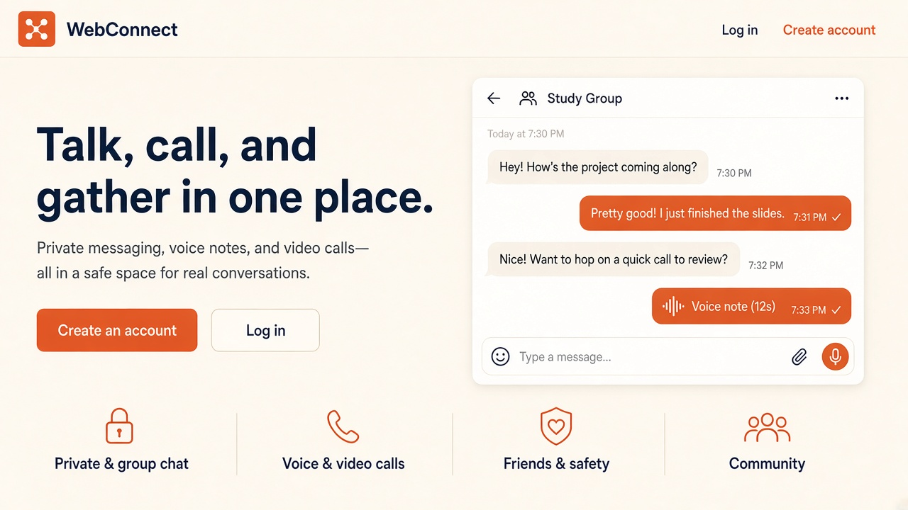
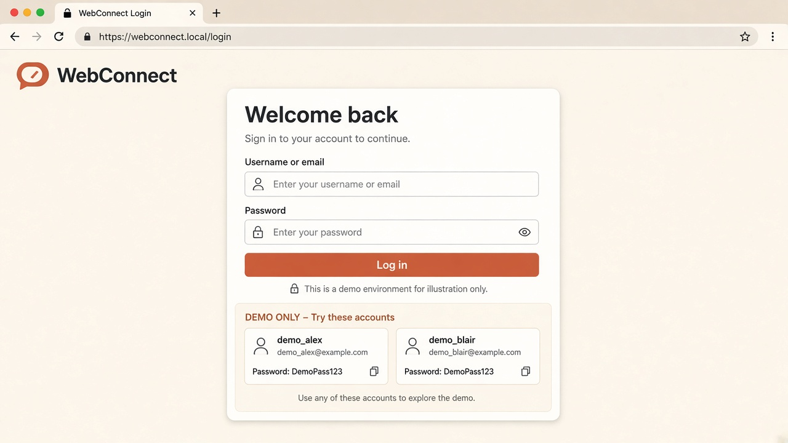
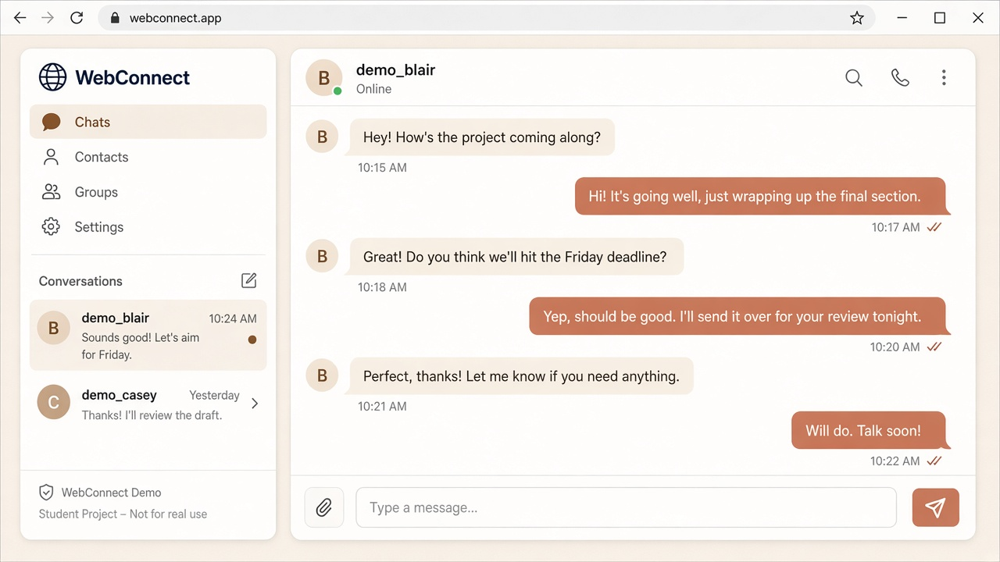
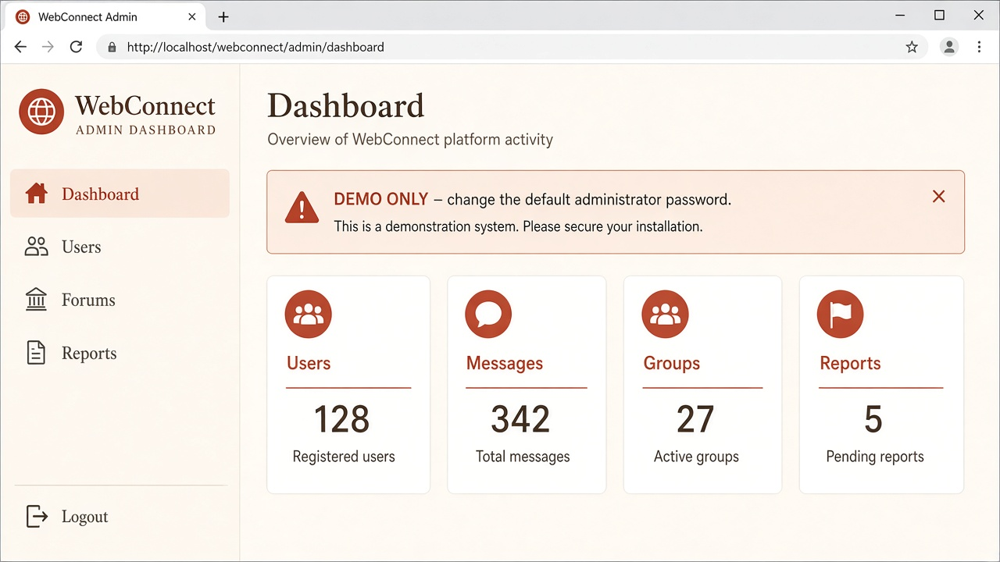

# WebConnect

WebConnect is a browser-based communication system for private chat, group chat, voice messages, file sharing, forums, and WebRTC voice/video calls.

It is a new PHP and MySQL application for XAMPP and cPanel. It does not use Laravel, Node.js, React, or Socket.IO.



| Login | Chat |
| --- | --- |
|  |  |



More images and capture notes: [docs/screenshots](docs/screenshots/).

## Requirements

- XAMPP (or another Apache + PHP + MySQL/MariaDB stack)
- PHP 8.2 or newer (PHP 8.3+ recommended; tested on the bundled XAMPP PHP 8.2)
- MySQL 5.7+ or MariaDB 10.4+
- A current version of Chrome, Edge, or Firefox
- Apache `mod_rewrite` is not required
- The `fileinfo` PHP extension (enabled in a normal XAMPP install)

Microphone and camera access are required for voice messages and calls. Calls on a public server need HTTPS.

## Installation on XAMPP

1. Copy this project into the Apache document root. For this workspace that path is:

   `C:\xampp\htdocs\Web-based_chat_message_system`

2. Start **Apache** and **MySQL** from the XAMPP control panel.
3. Create the database and tables by importing `database/database.sql`. In phpMyAdmin, choose Import and select that file. Or from a terminal:

   ```text
   C:\xampp\mysql\bin\mysql.exe -u root --default-character-set=utf8mb4 < database\database.sql
   ```

   The script creates a database named `webconnect`. Re-importing drops and recreates the WebConnect tables.

4. Default local credentials live in `includes/config.php`:

   - Host: `127.0.0.1`
   - Database: `webconnect`
   - User: `root`
   - Password: empty
   - App URL: `http://localhost/Web-based_chat_message_system`

5. If your folder name, host, or database password is different, copy `includes/config.local.php.example` (or follow `includes/database.example.php`) to `includes/config.local.php` and set `DB_HOST`, `DB_NAME`, `DB_USER`, `DB_PASS`, and `APP_URL`. Do not put production passwords in `config.php`. `config.local.php` is gitignored.
6. Make sure PHP can write to `uploads/` and `logs/`. XAMPP on Windows usually can. On Linux, give the web server write permission to those folders.
7. Open `http://localhost/Web-based_chat_message_system/`.

Uploaded files are not served directly. Apache is told to deny HTTP access to `uploads/`, `includes/`, `database/`, `logs/`, and `tests/`. The application serves media through `api/media.php` after checking the session and permission.

## cPanel deployment

1. Create a MySQL database and a database user in cPanel. Grant that user all privileges on the database.
2. Import `database/database.sql` with phpMyAdmin. If the host already created the database, you can remove the `CREATE DATABASE` and `USE` lines and import the rest into the database cPanel assigned.
3. Upload the project files into `public_html` (or a subfolder).
4. Copy `includes/config.local.php.example` to `includes/config.local.php` and set the cPanel database name, user, password, and the public `APP_URL` (for example `https://example.com`).
5. Turn on HTTPS (AutoSSL or Let's Encrypt) and use the `https://` URL in `APP_URL`. Browsers block microphone and camera access on non-localhost HTTP sites.
6. Set `uploads/` and `logs/` to writable (`755` is often enough; use `775` if uploads fail).
7. Confirm `uploads/.htaccess` is present so private files are not downloaded by guessing a path.
8. Log in as the administrator, change the demo password, then test registration, chat, uploads, and a call.

## WebRTC calls

Voice and video calls use `RTCPeerConnection` in the browser. PHP only stores the offer, answer, and ICE candidates. The clients poll those signals.

- The microphone and camera prompts must be allowed.
- `http://localhost` can use the microphone without HTTPS. Any other host needs HTTPS.
- The default ICE server is Google's public STUN server: `stun:stun.l.google.com:19302`.
- STUN helps two peers find each other. Some school, office, and mobile networks still cannot connect without a TURN relay.
- Add a TURN server in `includes/config.local.php` with `RTC_ICE_SERVERS`. An example is in `config.local.php.example`.
- The call screen shows **Connected** only after the WebRTC connection state is actually `connected`.
- If the connection fails, the screen says the network may require a TURN server. That is a network limit, not a hidden success state.

## DEMO ONLY accounts

The SQL file inserts demonstration accounts so the interface is not empty. They are not safe for a public server.

| Account | Sign-in | Password | Notes |
| --- | --- | --- | --- |
| Administrator | `admin` | `AdminDemo123!` | Separate admin login at `/admin/login.php`. The dashboard is locked until this password is changed. |
| Member | `demo_alex` | `DemoPass123` | Friends with Blair and Casey |
| Member | `demo_blair` | `DemoPass123` | Has a pending request from Casey |
| Member | `demo_casey` | `DemoPass123` | Member of the Study Circle group |

Change or delete these accounts before anyone else can reach the site. Create the real administrator by updating the `admins` row after you set a new `password_hash` with PHP `password_hash()`.

## What you can do

Members can register, edit a profile, upload an avatar, search people, manage friend requests, block users, and exchange private or group messages (text, images, files, and voice notes). Messages support replies, reactions, deletion, delivery/read state, typing, and presence. Friends can place voice and video calls with mute, camera, and hang-up controls. The community forums support posts, comments, likes, shares, and reports.

Administrators use `/admin/login.php`. The panel shows user, message, group, forum, and report counts, and it can enable, disable, or delete users, manage forum categories and posts, and review reports.

## Project layout

- `index.php`, `login.php`, `register.php`, `chat.php`, `friends.php`, `groups.php`, `group_chat.php`, `forums.php`, `notifications.php`, `profile.php` are the member pages.
- `admin/` is a separate administrator session.
- `api/` returns JSON for chat, calls, presence, media, and the other live features.
- `includes/` holds configuration, PDO, authentication, security, and domain logic.
- `database/database.sql` is the schema.
- `includes/database.example.php` and `includes/config.local.php.example` show safe placeholder DB settings.
- `docs/screenshots/` holds README UI previews.
- `assets/` holds CSS and vanilla JavaScript.
- `uploads/` stores avatars and message files under randomized names.
- `LICENSE` is MIT.

## Polling

There is no Socket.IO server. Signed-in pages use `fetch` against the PHP APIs:

- Messages about every 3 seconds while a conversation is open
- The conversation list about every 6 seconds
- Notifications about every 12 seconds
- Presence about every 20 seconds
- Call signalling about every 1.2 seconds while a call is on screen
- Typing indicators expire after a few seconds

## Security notes

- Passwords are stored with `password_hash()` and checked with `password_verify()`.
- SQL uses PDO prepared statements.
- Pages escape text with `htmlspecialchars()`.
- State-changing requests need a session CSRF token.
- Session cookies are HTTP-only, `SameSite=Lax`, and marked Secure when HTTPS is on.
- Uploads check the extension, the detected MIME type, a file signature, and the maximum size. Stored names are random.
- `api/media.php` checks that the viewer may see the file, blocks path traversal, and supports HTTP range requests for audio seeking.
- Login, messages, friend requests, forum posts, reports, and calls are rate limited.

Errors shown to visitors are generic. Details are appended to `logs/app.log`.

## Local test

With MySQL running and the schema imported:

```text
C:\xampp\php\php.exe tests\smoke.php
```

That script creates temporary users, exercises the main server features, and deletes those users. It does not replace a real browser check of the microphone, camera, or a two-person WebRTC call.
